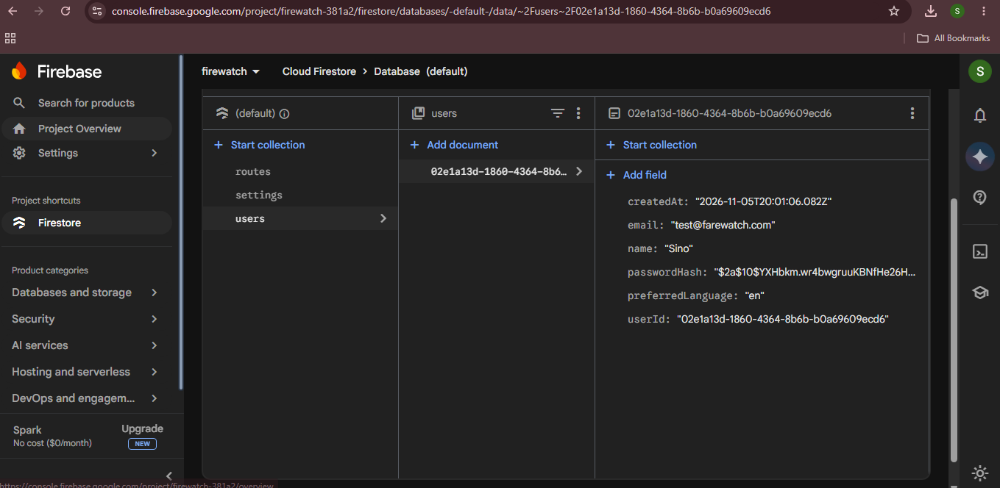
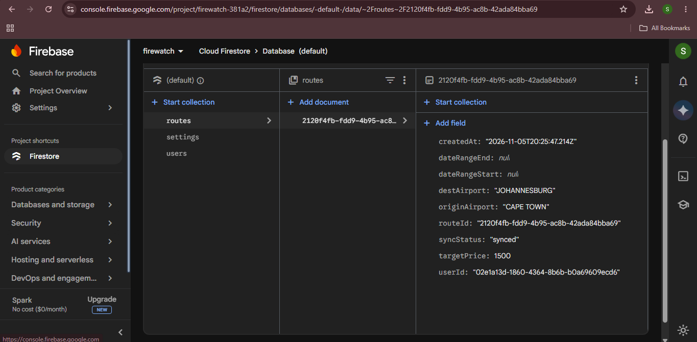

# FareWatch ✈️

An Android app that helps travellers track airline ticket prices and spot discounts on the routes they care about.

**Student:** Sinoxolo Mkosi (ST10445407) | **Module:** OPSC6312 | **Rosebank College (The IIE)**

🎥 **Demo video:** [YOUTUBE LINK]

🔗 **API repository:** https://github.com/SinoMkosi/farewatch-api

---

## 1. Purpose of the app

Flight prices change many times a day. Students and budget travellers often miss cheap fares because they are not watching at the right moment. FareWatch lets a user keep a personal watchlist of routes with a target price, and the backend tracks prices and flags when a route becomes a bargain.

FareWatch does not sell tickets. It only tracks prices and discounts, unlike the apps I researched in Part 1 (Skyscanner, Hopper and KAYAK).

## 2. Design considerations

- **Kotlin Android app:** Retrofit handles network calls and coroutines handle background work.
- **REST API:** built with Node.js and Express (separate repository, linked above).
- **NoSQL database:** Google Firestore stores users, routes, price snapshots, alerts and settings.
- **Security:** passwords are hashed with bcrypt before storing, and logins return a signed JWT token. Plain-text passwords are never stored.
- **Input validation:** the app and API reject empty or invalid input and show a message instead of crashing.
- **Blob storage:** a Supabase Storage bucket (`profile-pictures`) was created for image uploads.
- **Buy/Wait guidance:** the API compares the latest price with the average of the last 14 price snapshots and returns `BUY_NOW` or `WAIT`.

## 3. Screenshots

**Firestore `users` collection (password stored as a bcrypt hash):**

**Firestore `routes` collection (route added from the app):**

**Supabase Storage bucket (blob storage):**

**GitHub Actions build and test run:**

## 4. What works in this version

| Feature | Status |
|---|---|
| Register (REST API, bcrypt-hashed password) | Working |
| Login with email and password | Working |
| Add a watched route (origin, destination, target price) | Working |
| REST API connected to a NoSQL database (Firestore) | Working |
| Price history and Buy/Wait guidance | Working in the API |
| Settings, alerts and sync endpoints | Working in the API |
| Automated build and tests with GitHub Actions | Working |
| Supabase blob storage bucket | Created |

The project uses Git for version control. A GitHub Actions workflow (`.github/workflows/android.yml`) runs on every push:

1. Checks out the code
2. Sets up Java 17
3. Runs the unit tests (`./gradlew test`)
4. Builds the debug APK (`./gradlew assembleDebug`)
5. Saves the APK as a downloadable artifact

This shows the app builds on a clean machine, not just on my laptop.

## 7. Release notes

### Version 3.0 (Final PoE): changes since the Part 2 prototype

- **Moved the database from SQLite to Firestore (NoSQL)** so data is stored, read and written in a NoSQL database.
- Rewrote the API with error handling so the server returns clean errors instead of crashing.
- Added input validation for registration, login, routes and prices.
- Moved the Android app into its own repository, `FareWatch-app`.
- Added **GitHub Actions** to build and test the app automatically.
- Created a **Supabase Storage** bucket for blob storage.
- **Innovative feature:** Buy/Wait price guidance. It compares the current price with the 14-snapshot average and advises `BUY_NOW` or `WAIT`. It is available through the API.

## 8. How to run it

1. Start the API (`node server.js`) with the Firebase service-account key and `JWT_SECRET` set.
2. Update `BASE_URL` in `RetrofitClient.kt` to the API address.
3. Open the project in Android Studio and run it on an Android phone.
4. Log in with an account created through `/auth/register`.

## 9. References

- Firebase Documentation: https://firebase.google.com/docs
- Supabase Storage: https://supabase.com/docs/guides/storage
- Android Developers: https://developer.android.com/
- Retrofit: https://square.github.io/retrofit/
